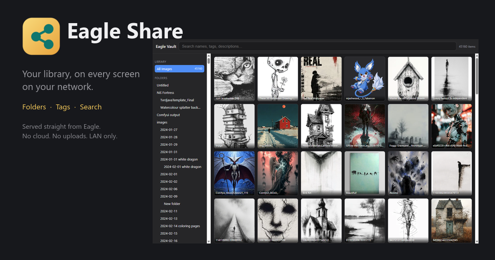

# Eagle Share

An Eagle plugin that makes your open library browsable from any device on your
local network — an Eagle-style web gallery served straight out of the app.

## What it does

- Auto-starts with Eagle (background-service plugin)
- Click the plugin in Eagle's plugin panel to open the control window:
  **Start sharing** flips a live web gallery on your LAN
- Browse by folders, tags, and search; tap any image for full-size + download
- QR code + copyable URL for phones/tablets
- Adjustable port and optional PIN — all inside the panel
- Follows library switches; re-indexes automatically when Eagle modifies the vault

## Install

1. Eagle → plugin panel → install the `.eagleplugin` file (or drop this folder
   into `Eagle/Plugins/`)
2. Restart Eagle — "Eagle Share" appears in the plugin list
3. Click it → **Start sharing**
4. One-time Windows Firewall prompt may appear — allow on **Private networks**

Open the URL shown in the panel — `http://<your-LAN-IP>:8321` — from any
device on the same network, or scan the QR code. The plugin detects your
machine's LAN address automatically; nothing to configure.

## Privacy

- Binds only to your LAN interface — never the VPN tunnel, never the internet
- Read-only: the plugin never writes into your `.library`
- Optional PIN gate; blank = open to anyone on the LAN
- If another gallery service already owns the port, the panel reports
  "Already running" instead of fighting over it

## Security

- Host-header allowlist on every request — blocks DNS-rebinding, the main way
  web pages could otherwise read a LAN service
- Optional PIN: `HttpOnly`+`SameSite` cookie, timing-safe compare, config
  changes disabled over the network when no PIN is set
- `nosniff` + `default-src 'none'` on all file responses (SVG can't run script
  in the gallery origin)
- Loopback-only control channel; writes require a header cross-origin pages
  cannot set
- Rescan throttled; request bodies capped; no telemetry, no outbound calls

## Requirements

Eagle 4.0+. Windows/macOS. No external dependencies — the server runs inside
Eagle's own Node environment.
